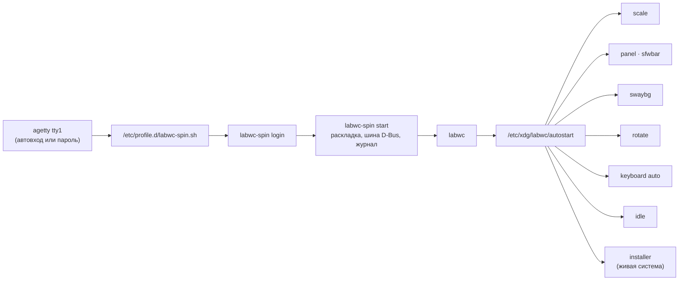

<div align="center">

# cleanlinux-spin-labwc

**Рабочий стол labwc для [CleanLinux](https://github.com/vovawees/CleanLinux): ПК, ноутбуки и портативные консоли**


[](LICENSE)

[Возможности](#возможности) · [Сеанс](#как-запускается-сеанс) · [Клавиши](#клавиши) · [Настройка](#настройка) · [Установка](#установка) · [Состав](#состав) · [Ограничения](#ограничения) · [English](#english)

</div>

Сборка (spin) CleanLinux с [labwc](https://labwc.github.io/) — лёгким стековым Wayland-композитором в
духе Openbox — и всем, что нужно для работы: панель с меню приложений, экранная клавиатура, автоповорот,
масштаб по DPI, уведомления, блокировка, скриншоты. Только Wayland, без Xwayland (`SPIN_FEATURES="wayland -x11"`).
Формат сборок и контракт с базой — [docs/SPINS.md](https://github.com/vovawees/CleanLinux/blob/main/docs/SPINS.md).

## Возможности

| Что | Чем | Как |
|---|---|---|
| Запуск после входа | `labwc-spin login` из `/etc/profile.d` | на tty1 рабочий стол стартует сам; с автоматическим входом (консоли) — сразу после загрузки |
| Панель | [sfwbar](https://github.com/LBCrion/sfwbar) | меню приложений, окна, трей, уведомления, Bluetooth, сеть и Wi-Fi (iwd), звук, яркость, батарея, раскладка, часы, меню сеанса |
| Экранная клавиатура | [wvkbd](https://github.com/jjsullivan5196/wvkbd) | кнопка на панели и Super+K; на сенсорном экране сама появляется в полях ввода; кириллица при русской раскладке |
| Сенсор | libinput, патчи labwc | касания идут на встроенный экран и поворачиваются вместе с ним |
| Автоповорот | iio-sensor-proxy | встроенный экран следует акселерометру от своей ориентации панели; Super+O — блокировка |
| Масштаб по DPI | `labwc-spin scale`, wlr-randr | шаг 0,25 по размеру экрана из EDID; не меньше 600 логических точек по короткой стороне |
| Раскладка | `labwc-spin start` | берётся из консоли (`/etc/vconsole.conf`, установщик): `us,ru`, переключение Alt+Shift |
| Обои, блокировка | swaybg, swaylock, swayidle | блокировка через 5 минут и перед сном (кроме живой системы и автоматического входа) |
| Скриншоты, буфер | grim, slurp, wl-clipboard | Print — экран, Shift+Print — область; файл в `~/Pictures` и в буфере |
| Звук, Bluetooth | PipeWire, WirePlumber, BlueZ | клавиши громкости через `wpctl`; наушники Bluetooth (A2DP, HFP) |
| Сеанс, питание | elogind, polkit, turnstile | выход, сон, перезагрузка и выключение без sudo — у пользователя за экраном |
| Тема | Adwaita, CleanLinux | GTK — Adwaita (панель — тёмная), иконки и курсоры — `CleanLinux`, шрифт DejaVu |
| Без драйвера GPU | wlroots pixman | если у Mesa нет драйвера видеокарты, labwc сам перезапускается с программной отрисовкой |

## Как запускается сеанс



- **Пользователь на tty1** — рабочий стол стартует при входе; «Выйти» завершает вход, автоматический вход
  тут же запускает стол снова. Консоль — Ctrl+Alt+F2. На других консолях — подсказка `labwc-spin start`.
- **Живая система** (пункт загрузки «CleanLinux live (labwc)») — root входит сам, стол стартует на основной
  консоли, установщик открывается в окне (и в меню приложений — «Install CleanLinux»). С пунктом «serial console»
  стол не стартует: установщик — на последовательной консоли.
- **labwc не запустился** — журнал `~/.cache/labwc.log`, оболочка остаётся; `labwc-spin start` — ещё раз.

## Клавиши

| Клавиши | Действие |
|---|---|
| Super | меню рабочего стола (то же — правый клик по столу) |
| Super+Return | терминал foot |
| Super+K | экранная клавиатура |
| Super+O | блокировка поворота экрана |
| Super+L | заблокировать экран |
| Print, Shift+Print | скриншот экрана, области |
| Alt+Tab, Alt+F4 | окна, закрыть окно |
| Super+стрелки, Super+A, Super+D | окно к краю, развернуть, показать стол |
| клавиши громкости, яркости | `wpctl`, `brightnessctl` |

## Настройка

| Файл | Что | Свой — |
|---|---|---|
| `/etc/xdg/labwc/rc.xml` | тема, клавиши, тачпад | `~/.config/labwc/rc.xml` (заменяет целиком) |
| `/etc/xdg/labwc/menu.xml` | меню рабочего стола | `~/.config/labwc/menu.xml` |
| `/etc/xdg/labwc/autostart` | что стартует вместе с labwc | `~/.config/labwc/autostart` |
| `/etc/xdg/labwc/environment` | окружение: раскладка, рендерер, `LABWC_SPIN_*` | `~/.config/labwc/environment` |
| `/etc/xdg/sfwbar/sfwbar.config` | панель | `~/.config/sfwbar/sfwbar.config` |
| `/etc/gtk-3.0/settings.ini` | иконки, шрифт GTK | `~/.config/gtk-3.0/settings.ini` |
| `/etc/xdg/foot/foot.ini` | терминал (шрифт 11 pt) | `~/.config/foot/foot.ini` |

Переменные (`environment`): `LABWC_SPIN_SCALE=off` или `1.5` — без автомасштаба или свой масштаб;
`LABWC_SPIN_KEYBOARD=wvkbd-deskintl` — полная клавиатура; `LABWC_SPIN_IDLE=600` или `off` — блокировка через
600 с или никогда; `LABWC_SPIN_ROTATE=off` — без автоповорота; `WLR_RENDERER=pixman` — программная отрисовка.
Не запускать стол на tty1: `touch ~/.config/labwc-spin/no-autostart`. Все команды: `labwc-spin --help`.

Системные копии в `/etc` — `backup=` рецептов: правки администратора переживают обновления.

## Установка

| Способ | Как |
|---|---|
| Живой образ | образ `cleanlinux-…-labwc-….img` из [релизов CleanLinux](https://github.com/vovawees/CleanLinux/releases): пункт загрузки «CleanLinux live (labwc)» |
| Установщик | экран «Система» → «Рабочий стол: labwc» (слой сборки копируется на диск) |
| В готовую систему | `sudo burn spin add https://github.com/vovawees/cleanlinux-spin-labwc`, затем войти на tty1 |
| Свой образ | `bootstrap/bootstrap.sh --spin https://github.com/vovawees/cleanlinux-spin-labwc live` в CleanLinux |

Обновление — вместе с базой: `burn sync && burn plan && burn update`. Удалить: `sudo burn spin remove labwc`.

## Состав

| Пакет | Версия | Что |
|---|---|---|
| `labwc`, `wlroots` | 0.20.3, 0.20.2 | композитор; патчи: ориентация панели консолей из DRM, сенсор — на встроенный экран |
| `sfwbar` | 1.0~beta17 | панель (GTK 3, gtk-layer-shell) |
| `wvkbd` | 0.21 | экранные клавиатуры `wvkbd-mobintl` (компактная) и `wvkbd-deskintl` (полная) |
| `swaybg`, `swaylock`, `swayidle` | 1.2.2, 1.8.6, 1.9.1 | обои, блокировка (PAM), простой |
| `grim`, `slurp`, `wl-clipboard` | 1.5.0, 1.5.0, 2.3.0 | скриншоты, выбор области, буфер обмена |
| `brightnessctl`, `wlr-randr` | 0.5.1, 0.5.0 | яркость (группа video), экраны |
| `foot`, `fcft`, `tllist` | 1.28.0, 3.3.3, 1.1.0 | терминал |
| `dejavu-fonts` | 2.37 | шрифты |
| `cleanlinux-icon-theme` | 51.0 | символьные иконки Adwaita в PNG (GTK без librsvg), курсоры, значок меню |
| `labwc-spin` | 2 | настройки и `labwc-spin`: вход, масштаб, поворот, клавиатура, блокировка, скриншоты, обои |
| из базы | | `iio-sensor-proxy` 3.9, `bluez` 5.87, `pipewire` 1.6.11, `wireplumber` 0.5.19, `elogind` 257.16, `polkit` 128, `turnstile` 0.1.11, `seatd` 0.9.3, `gtk3` 3.24.52, `gdk-pixbuf-nanosvg`, `mesa` 26.2.6 |

Сервисы: системные `dbus`, `elogind`, `polkitd`, `seatd`, `turnstiled`, `bluetoothd`; у каждого пользователя
(`dinit --user` через turnstile) — `dbus`, `pipewire`, `wireplumber`.

```text
cleanlinux-spin-labwc/
├── spin.conf                  пакеты, возможности (FEATURES) и сервисы сборки
├── packages/
│   ├── labwc-spin/            labwc-spin, rc.xml, menu.xml, autostart, environment, sfwbar.config, обои
│   ├── labwc/ wlroots/        композитор и его патчи
│   ├── sfwbar/ wvkbd/ …       панель, клавиатура, обои, блокировка, скриншоты, терминал
│   └── cleanlinux-icon-theme/ иконки и курсоры (svg2rgba на NanoSVG, icons.py, cursors.py)
└── tools/                     check.sh (перед push), lint.sh, hooks/pre-push
```

## Ограничения

- **Видеокарты Intel и Mali (Panfrost)** в готовых образах — без драйвера Mesa: ему нужен LLVM, а база его
  пока не собирает. labwc работает с программной отрисовкой (pixman), OpenGL-программы — через softpipe.
  Своё железо: `burn` пересоберёт `mesa` с `video_cards_intel` (или `panfrost`), собрав и `llvm`.
- Масштаб и поворот задаются при старте сеанса; монитор, подключённый позже, — через `wlr-randr`.
- На реальных консолях (Steam Deck и др.) сборка пока не проверена — нужны отчёты ([issues](https://github.com/vovawees/CleanLinux/issues)).

## Проверка

```sh
tools/check.sh            # shellcheck, имена пакетов — из сборки или базы, исходники и их sha256
tools/check.sh --quick    # без скачивания (хук pre-push)
```

## Лицензия

Рецепты, настройки, `labwc-spin` и обои — MIT. Пакеты — под своими лицензиями (`license=` в рецептах).

## English

A labwc spin of CleanLinux: labwc with the sfwbar panel (app menu, taskbar, tray, notifications,
Bluetooth, network, sound, brightness, battery, layout, clock, session), the wvkbd on-screen keyboard
(shown for text fields on touch screens), rotation by the accelerometer, DPI scaling, swaylock/swayidle,
screenshots and the clipboard. The desktop starts at the login on tty1 (with automatic login on handhelds:
right after boot); the live image starts it on its main console with the installer in a window. Settings:
`/etc/xdg/labwc`, `/etc/xdg/sfwbar/sfwbar.config`, `LABWC_SPIN_*` in labwc's `environment`;
`labwc-spin --help`. GPUs without a Mesa driver in the images (Intel, Panfrost: Mesa needs LLVM for them)
fall back to the pixman renderer.
